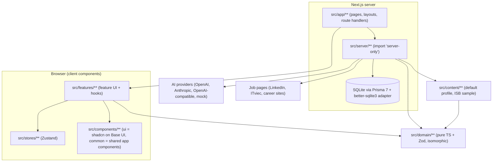
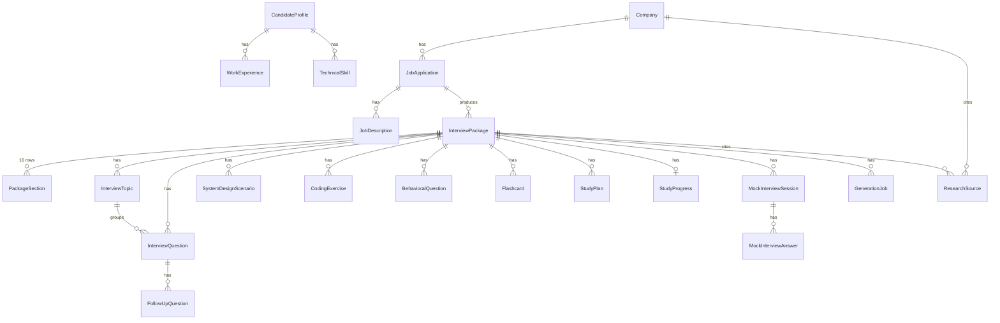
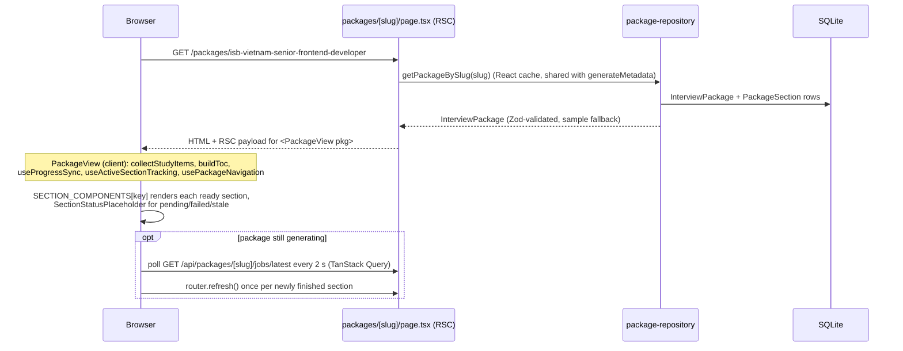
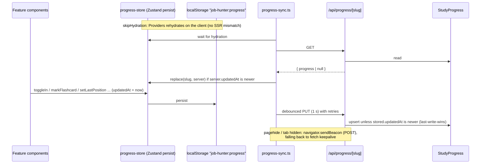
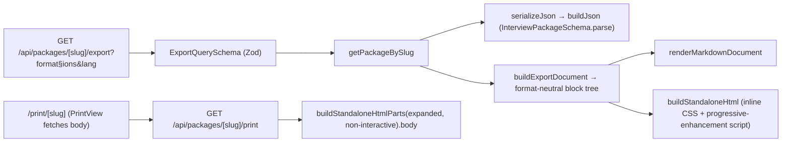
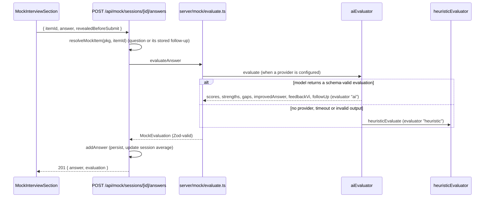
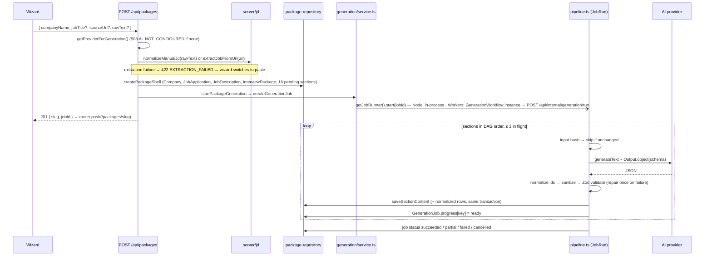
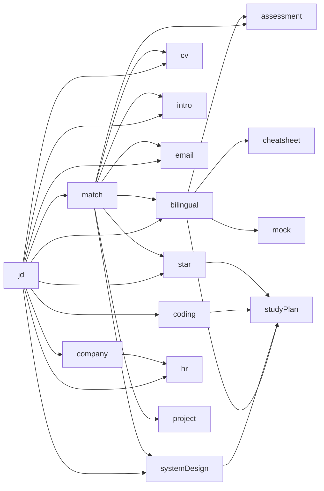

# Job Hunter: Architecture

Job Hunter is a **modular monolith**: a single Next.js 16 (App Router) application. The code is organized
by domain and feature, and the dependency rules between layers are strict. There is no separate backend
service. Route handlers, server components and an in-process generation pipeline share one Node.js process
and one database.

Related documents: [`RUN_10_SPECIFICATION.md`](RUN_10_SPECIFICATION.md) (package contents),
[`PROMPTS.md`](PROMPTS.md) (prompt templates), [`DEPLOYMENT.md`](DEPLOYMENT.md),
[`REQUIREMENTS.md`](REQUIREMENTS.md) (original brief).

## 1. Layers

| Layer      | Path                                               | Rules                                                                                                                                                                                                                                                                                                                                                                                                                                                                                                                                                                                                                                                                        |
| ---------- | -------------------------------------------------- | ---------------------------------------------------------------------------------------------------------------------------------------------------------------------------------------------------------------------------------------------------------------------------------------------------------------------------------------------------------------------------------------------------------------------------------------------------------------------------------------------------------------------------------------------------------------------------------------------------------------------------------------------------------------------------- |
| Domain     | `src/domain/**`                                    | Pure TypeScript + Zod, no React, no Prisma, no `server-only`, so it can be imported on both sides. The Zod schemas are the **single source of truth** for seed content, AI output, API payloads and stored JSON. Holds the business rules: section registry and DAG (`package/sections.ts`), bookmarks, study items, search and filters, match score, mock scoring, export builders, JD normalization, profile and progress schemas.                                                                                                                                                                                                                                         |
| Server     | `src/server/**`                                    | Never imported by client code. The entry modules that touch secrets, the database or the network (`db.ts`, `ai/provider.ts`, repositories, `generation/service.ts` and `pipeline.ts`, `jd/index.ts` and `extract.ts`, `cv/`, `mock/evaluate.ts`) import `"server-only"`. Pure helpers next to them (prompts, normalization, URL guard) skip it so they stay unit-testable. Holds the Prisma client (`db.ts`), repositories (Zod-validate on every write, map rows to domain objects), the AI provider and prompts (`ai/`), the generation pipeline (`generation/`), SSRF-safe JD extraction (`jd/`), CV text extraction (`cv/`) and the mock-interview evaluators (`mock/`). |
| Features   | `src/features/<feature>/**`                        | Client UI and hooks for one feature: `app-shell`, `package-view`, `sections`, `questions`, `study`, `flashcards`, `mock-interview`, `generation`, `export`, `profile`. Business logic is delegated to `src/domain` or `src/server`, and pure helpers (e.g. `flashcards/deck.ts`, `mock-interview/mock-plan.ts`) are kept framework-free.                                                                                                                                                                                                                                                                                                                                     |
| Components | `src/components/ui/**`, `src/components/common/**` | `ui` holds the shadcn/ui primitives on **Base UI** (`@base-ui/react`, not Radix). `common` holds the shared app components (`BilingualText`, `Markdown`, `MermaidDiagram`, `CopyButton`, `CodeBlock`, `Badges`, `BookmarkMarker`).                                                                                                                                                                                                                                                                                                                                                                                                                                           |
| Stores     | `src/stores/**`                                    | Zustand. `preferences-store` (language, persisted), `progress-store` (study progress, persisted), `expansion-store` (accordion state and focus requests, not persisted). `features/package-view/active-section-store.ts` tracks the section being read.                                                                                                                                                                                                                                                                                                                                                                                                                      |
| Content    | `src/content/**`                                   | The curated default candidate profile and the ISB sample package (typed against the domain schemas and checked by tests).                                                                                                                                                                                                                                                                                                                                                                                                                                                                                                                                                    |
| App        | `src/app/**`                                       | Routes. The `(app)` group renders the `AppShell`. `print/[slug]` is outside the shell. Route handlers live in `src/app/api/**`. DB-backed routes use `export const dynamic = "force-dynamic"` (`cacheComponents` is off).                                                                                                                                                                                                                                                                                                                                                                                                                                                    |

### Routes

| Route                                                                   | Kind | Purpose                                                                      |
| ----------------------------------------------------------------------- | ---- | ---------------------------------------------------------------------------- |
| `/`                                                                     | page | Dashboard: package cards with study progress, link to the sample             |
| `/packages/new`                                                         | page | Three-step wizard (`NewPackageWizard`)                                       |
| `/packages/[slug]`                                                      | page | Package view (16 sections, TOC, search, progress)                            |
| `/packages/[slug]/flashcards`, `/packages/[slug]/mock`                  | page | Full-page flashcard deck and mock interview                                  |
| `/profile`, `/settings`                                                 | page | Profile editor and CV upload; AI provider status and setup help              |
| `/print/[slug]?sections=&lang=&autoprint=`                              | page | Print view, fully expanded, for "Save as PDF"                                |
| `GET/POST /api/packages`                                                | API  | List packages; create a package and start generation (`201 { slug, jobId }`) |
| `GET/DELETE /api/packages/[slug]`                                       | API  | Read one package; delete a user package (samples return 403)                 |
| `POST /api/packages/[slug]/sections/[key]`                              | API  | Retry or regenerate one section (`{ force? }`, returns `202 { jobId }`)      |
| `POST /api/packages/[slug]/items/[itemId]/regenerate`                   | API  | Regenerate one Section 7 question                                            |
| `GET /api/packages/[slug]/jobs/latest`, `GET /api/generation-jobs/[id]` | API  | Job status (`GenerationJobDto`)                                              |
| `POST /api/generation-jobs/[id]/cancel`                                 | API  | Cancel a job                                                                 |
| `GET /api/packages/[slug]/export?format=md\|json\|html&sections=&lang=` | API  | File download                                                                |
| `GET /api/packages/[slug]/print?sections=&lang=`                        | API  | Print view body (`.jh-export` HTML fragment), fetched by `/print/[slug]`     |
| `POST /api/jd/extract`                                                  | API  | Fetch and normalize a job URL for the wizard preview                         |
| `GET/PUT/POST /api/progress/[slug]`                                     | API  | Study-progress sync (POST exists for `navigator.sendBeacon`)                 |
| `/api/mock/sessions[/[id][/answers\|/complete]]`                        | API  | Mock-interview sessions, answers and evaluation                              |
| `GET/PUT /api/profile`, `POST/DELETE /api/profile/cv`                   | API  | Candidate profile and CV upload                                              |
| `GET /api/ai/status`                                                    | API  | Active provider, model and configured flags (never secrets)                  |

## 2. Data model

`prisma/schema.prisma` defines 22 models. Every type used is PostgreSQL-compatible. Status fields are
plain strings, not database enums (for SQLite/Postgres portability), and their allowed values are enforced
by Zod in `src/domain`.

| Group            | Models                                                                                                                                                                                 | Notes                                                                                                                                                                                                                                                                   |
| ---------------- | -------------------------------------------------------------------------------------------------------------------------------------------------------------------------------------- | ----------------------------------------------------------------------------------------------------------------------------------------------------------------------------------------------------------------------------------------------------------------------- |
| Candidate        | `CandidateProfile`, `WorkExperience`, `TechnicalSkill`                                                                                                                                 | One profile, created from `src/content/profile/default-profile.ts` on first access. `WorkExperience.includeInGeneration` drives the Elfie exclusion. CV text is stored in `cvText`.                                                                                     |
| Application      | `Company` (`code` = bookmark token, unique), `JobApplication`, `JobDescription` (`rawText` + `normalized` NormalizedJd JSON, `origin` url/manual/seed), `ResearchSource`               | Created by `createPackageShell` in a single transaction. A company is reused when the name normalizes to the same code; otherwise it gets a suffix (`ACME_2`).                                                                                                          |
| Package          | `InterviewPackage` (unique `slug`, `companyCode`, `isSample`), `PackageSection` (`@@unique([packageId, key])`: `status`, `content` JSON, `error`, `inputHash`, `model`, `generatedAt`) | `PackageSection.content` is **the** source used to assemble an `InterviewPackage` (`assemblePackage` in `repositories/package-mapper.ts`).                                                                                                                              |
| Normalized lists | `InterviewTopic`, `InterviewQuestion`, `FollowUpQuestion`, `SystemDesignScenario`, `CodingExercise`, `BehavioralQuestion`, `Flashcard`, `StudyPlan`                                    | Written in the **same transaction** as the matching section (delete then recreate). They have stable `itemId`s and promoted columns (`number`, `difficulty`, `priority`) for queries and counts (e.g. the dashboard question count), and store the full item in `data`. |
| Study            | `StudyProgress` (`data` = PackageProgress JSON, one per package)                                                                                                                       | Last-write-wins on the payload's `updatedAt`.                                                                                                                                                                                                                           |
| Mock             | `MockInterviewSession` (`status`, `averageScore`), `MockInterviewAnswer` (`overall`, `evaluation` JSON, `revealedBeforeSubmit`)                                                        |                                                                                                                                                                                                                                                                         |
| Generation       | `GenerationJob` (`status`, `sections` JSON, `progress` JSON per section, `provider`, `model`, `error`, `cancelRequested`)                                                              | Polled by the UI. `cancelRequested` lets a cancel issued by another request reach the job.                                                                                                                                                                              |
| Preferences      | `UserPreference` (singleton `"default"`)                                                                                                                                               | Seeded. The UI currently keeps language and theme in `localStorage`.                                                                                                                                                                                                    |

**Why Json columns.** Run #10 content is deeply nested and bilingual (a question has about 16 fields,
follow-ups, optional code and diagrams), and its shape changes along with the prompts. Modeling every field
relationally would mean dozens of tables and a migration for every prompt tweak, and the app only ever reads
whole sections. So:

- Rich payloads are stored as JSON and **validated with Zod on every write** (`saveSectionContent` parses
  with `SectionContentSchemas[key]`) and again when read back (`assemblePackage` marks a section whose stored
  content no longer parses as `failed` with a readable error).
- Fields the app filters, sorts, counts or joins on are promoted to real columns (`slug`, `key`, `status`,
  `itemId`, `number`, `difficulty`, `priority`, `inputHash`).
- `Json` maps to `jsonb` on PostgreSQL, so the schema moves to Postgres unchanged (see `DEPLOYMENT.md`).

**Built-in sample fallback.** `getPackageBySlug` and `listPackages` merge the ISB sample from code. If
the sample is not in the database, or the database is unreachable, it is served straight from
`src/content/samples/isb`, so the app renders the sample even before `pnpm db:setup`. If a seeded sample row
is missing a section that the code has, that section is filled in from code (`overlayBuiltInSections`).
Slugs of built-in samples are never handed out to new packages.

## 3. Request flows

### 3.1 Package page rendering

- `PackageView` lays out the sticky `PackageToolbar` (global search, plus a "Contents" sheet below `xl`),
  the `PackageHeader` (with the export dialog), the 16 `PackageSection`s and, at `xl` and up, a right
  sidebar with `TableOfContents` and `ProgressPanel`. The app header (`AppHeader`) holds the language
  switch and theme toggle. The left sidebar (`SidebarNav`) is part of `AppShell` and lists every package.
- Accordion item bodies render **only while expanded** (`ItemAccordion`). `MermaidDiagram` loads the
  Mermaid library with a dynamic import, and only when the diagram scrolls near the viewport.
- The active section is tracked with an IntersectionObserver (`use-package-navigation.ts`) and stored in
  `active-section-store`. Components subscribe to it through narrow selectors (`useIsActiveAnchor`).

### 3.2 Progress persistence (localStorage + `/api/progress` sync)

- `useProgressSync(slug)` reference-counts one controller per slug, so every component can call it without
  duplicating network traffic.
- To prevent sync loops, `lastSynced` remembers the `updatedAt` known to match the server, and writes that
  came from the server are not echoed back.
- The route rejects bodies over 512 KB and validates them with `PackageProgressSchema`. For an unseeded
  sample, writes are accepted as no-ops and the progress stays in `localStorage`.

### 3.3 Search and auto-expand

1. `collectStudyItems(pkg)` (`domain/package/items.ts`) flattens questions, scenarios, exercises and STAR
   questions into `StudyItem`s. Each one has a lower-cased `searchText` containing **all** of its content,
   including fields that are hidden while collapsed.
2. `GlobalSearch` (a WAI-ARIA combobox opened with `/` or Ctrl/Cmd+K) runs `buildSearchResults`, which
   matches TOC entries (section and topic titles plus bookmarks) and items via `searchStudyItems`. All terms
   must match (AND), quoted phrases are supported, title matches rank higher, and each hit gets a snippet.
3. Choosing an item calls `focusStudyItem` → `useExpansionStore.focusItem(id, anchorId)`. This marks the item
   expanded and sets a `focusRequest` with a fresh nonce.
4. The matching `ItemAccordion` (subscribed to its own id with `useIsExpanded`) renders its body, scrolls
   itself into view, flashes and focuses its header. As a fallback, `navigation.ts` scrolls after 300 ms if
   the element is still off-screen.
5. Deep links work the same way: `#item-…` expands and focuses the item, and `#bookmark-…` scrolls to a
   section or topic. Without a hash, the last reading position (`lastAnchor` and `lastScrollY` in progress)
   is restored.

Section 7 has its own filter toolbar (`domain/package/filters.ts`: topic, difficulty, priority, kind,
studied / not studied / favorites, plus query). Criteria are combined with AND, and values within one
criterion with OR.

### 3.4 Export builders

- All builders live in `src/domain/export` and are pure functions, unit-tested with a fixture package.
  Markdown and HTML walk the **same** intermediate document, so both always contain the complete content,
  including everything that is collapsed in the app, plus bookmarks, anchors and a TOC.
- In the HTML export, items are `
` (they work without JavaScript), every text value is
  HTML-escaped, Markdown fields go through `renderMarkdown` (sanitize-html allowlist), links are checked with
  `isSafeHref`, and diagrams are rendered by Mermaid with `securityLevel: "strict"`. Mermaid is loaded from
  jsDelivr pinned to the bundled version with Subresource Integrity (`MERMAID_CDN_URL` / `MERMAID_SRI` in
  `html-assets.ts`; update both when bumping `mermaid`), and only when the export is interactive and has a diagram.
- The response is an attachment with `X-Content-Type-Options: nosniff` and `Cache-Control: no-store`.
- "PDF" is the print view (`/print/[slug]`): sections fully expanded, with `autoprint=1` opening the
  browser's print dialog. The page renders only the toolbar and CSS; `PrintView` fetches the body from
  `/api/packages/[slug]/print` after mount and injects it, so the large body is not also serialized into the RSC
  payload. Diagrams render and autoprint fires only after the body is in the document.

### 3.5 Mock interview evaluators

- **Scoring** (`domain/mock/scoring.ts`) is computed on the server in both cases: a weighted average of
  technical accuracy 0.35, senior judgment 0.25, communication 0.20 and completeness 0.20, minus a
  **2-point penalty** when the reference answer was revealed before submitting. The model's own "overall"
  is never trusted.
- The **heuristic** is deterministic and works offline. It uses coverage of key terms from the reference
  answer (memory shortcut and key takeaway weighted double), structure signals (trade-offs, failure cases,
  scale, examples, signposting) and length bands.
- The **AI evaluator** fences the question, reference answer and candidate answer in tags, tells the model
  to treat them as data, uses a 45 s timeout, and falls back to the heuristic on any error. With
  `AI_PROVIDER=mock` the mock model has no evaluation task, so the heuristic is used.
- The candidate chooses which questions to practice: 5, 10 or 15, ordered by priority or shuffled, with
  optional system-design, coding and behavioral items (`features/mock-interview/mock-plan.ts`).

## 4. AI generation pipeline

Code: `src/server/generation/**` (orchestration) and `src/server/ai/**` (provider, schemas, prompts, mock).

### 4.1 Provider abstraction (`server/ai/provider.ts`)

- `resolveAiConfig(env)` is a pure function that reads `AI_PROVIDER` (`openai | anthropic |
openai-compatible | mock`) and `AI_MODEL`. If `AI_PROVIDER` is empty, it auto-detects from the keys in the
  order OpenAI → Anthropic → OpenAI-compatible. **Mock is never auto-selected.**
- `getProviderForGeneration()` returns a `GenerationProvider` with `createModel()` built on
  `@ai-sdk/openai`, `@ai-sdk/anthropic` or `@ai-sdk/openai-compatible` (with `supportsStructuredOutputs`),
  or on the offline mock `LanguageModel`. OpenAI gets `strictJsonSchema: false` because the domain schemas
  have optional fields.
- `DEFAULT_MODELS` holds the model per provider (`gpt-5-mini`, `claude-sonnet-5-5`,
  `llama-3.3-70b-instruct`, `mock-run10-v1`). Changing it upgrades every generation at once.
- `getAiStatus()` (`/api/ai/status`, `/settings`) reports the provider, the model and whether it is
  configured. It never includes key values.
- The **mock provider** (`server/ai/mock/`) is a real AI SDK `LanguageModel`. It parses the `<task_spec>`
  that each prompt ends with and returns deterministic, schema-valid `[MOCK]` content built from the JD,
  the profile and the dependencies. `MOCK_*` variables inject failures (see README).

### 4.2 Section DAG and scheduling

`SECTION_DEFINITIONS[key].dependsOn` (`src/domain/package/sections.ts`) defines the DAG:

`JobRun.run()` loops over the requested sections in canonical order. A section starts when every requested
dependency has finished as `ready` or `skipped`, with at most `DEFAULT_CONCURRENCY = 3` sections in flight.
A shared async limiter (`registry.ts#createLimiter`) also caps **model calls** at 3, which matters for the
bilingual section because it fans out into one call per topic.

- **Failure isolation.** A failed section does not stop the job. Its dependents in the same job fail fast
  ("Skipped because … did not generate. Retry it first."). A dependency that is not in the job and has no
  content also fails the section ("Requires … to be generated first."). `startSectionGeneration` avoids
  this by expanding a retry with any missing dependencies (`expandSectionsWithMissingDependencies`).
- **Keeping existing content.** If regenerating a section that already had content fails, the content stays
  and only `error` ("Regeneration failed: …") is recorded. Cancelling restores the section's previous state.
- **Staleness.** When a job changes a section that already had content, its transitive dependents that are
  outside the job and `ready` are marked `stale`, and the UI offers **Regenerate** on them.
- **Final status.** All ready or skipped gives `succeeded`; some failed gives `partial` (with a list of the
  failed sections); all failed gives `failed`; any cancelled gives `cancelled`.
- **Job lock.** Only one active job is allowed per package (`409 JOB_RUNNING`). Samples are read-only
  (`403 SAMPLE_READ_ONLY`).
- **Orphans.** A job persisted as `queued` or `running` that is not registered in this process and is older
  than 15 s is marked `failed` ("interrupted (server restarted)") when it is next read, so the UI never
  polls forever.

### 4.3 Bilingual question bank (Section 7)

Generating one call for 40 to 60 fully bilingual questions would be large and fragile, so it is split:

1. **Topic plan** (`TopicPlanSchema`): 4 to 10 topics, each with a kebab-case `id`, an UPPER_SNAKE `code`,
   a `questionCount` of 3 to 12, focus areas and the JD requirements it covers. `normalizeTopicPlan` makes
   ids and codes unique and rescales the counts so the total lands within 40 to 60 (higher-priority topics
   gain questions first and lose them last).
2. **One batch per topic** (`questionBatchSchema(count)`), run in parallel through the limiter. The batches
   share an `AbortController`, so one failed batch stops its siblings.
3. **Merge** (`mergeQuestionBatches`): questions are numbered 1..N in plan order and get ids
   `<prefix>-q01…`, follow-up ids `<qid>-f1…`, and topic `range`s such as `"1–7"`. The result is validated as
   a `QuestionBank`.
4. **Single-question regeneration** (`regenerate-question.ts`) uses `SingleQuestionSchema` and the topic and
   sibling questions as context. It keeps the id, number and topic and replaces the question with
   `replaceQuestion`.

### 4.4 Structured output, validation and repair (`generation/structured.ts`)

Each model call is one `generateStructured()`:

- `generateText({ instructions: SYSTEM_PROMPT, messages, output: Output.object({ schema, name }),
maxRetries: 0, maxOutputTokens: 16_000, timeout: 300_000, abortSignal, providerOptions })`.
- The schema is the domain schema extended with the counts from the brief (`server/ai/schemas.ts`,
  `GENERATION_COUNTS`), so the provider receives them as JSON Schema `minItems`/`maxItems`.
- `postProcess` normalizes ids, drops references to unknown ids, sanitizes, and then parses with the
  **domain** schema. A `ZodError` here counts as a validation failure, the same as a schema mismatch.
- **Repair.** On a validation failure (`NoObjectGeneratedError`, `JSONParseError`, `TypeValidationError` or
  `ZodError`) there is exactly **one** repair attempt. The model gets its own raw output plus
  `buildRepairPrompt()` listing up to 30 `path: message` issues. If that fails too, the error is a
  `SectionGenerationError("VALIDATION_FAILED")` with a readable message.
- **Backoff** (`retry.ts`). `withRetry` retries 408, 409, 429, 5xx and network errors up to 4 attempts, with
  exponential delays (1 s base, plus up to 250 ms of jitter, at most 60 s). It honours `retry-after-ms` and
  `retry-after` (seconds or HTTP date), and the sleep can be aborted. Validation errors and other 4xx are
  not retried.
- **Readable errors** (`errors.ts#describeError`): 401/403 becomes "rejected the API key", 429 becomes
  "rate limit exceeded", and so on. These messages never include secrets or request bodies.

### 4.5 Input hashing (`generation/hash.ts`)

`computeSectionInputHash` = `sha256(stableStringify({ PROMPT_VERSION, section, templateVersion, meta, jd,
profileForGeneration(profile), dependencies }))`:

- `jd` includes only the fields that affect generation (extraction timestamp and warnings are excluded).
- `profileForGeneration` is the same generation-safe view the prompt uses: excluded experiences removed,
  and CV lines that mention excluded companies dropped.
- `dependencies` is the full content of the section's `dependsOn` sections.
- `stableStringify` sorts object keys, so equivalent inputs hash the same.

A section is skipped (job progress `skipped`) when `force` is not set, it is `ready`, it has content and the
hash matches. Bumping `PROMPT_VERSION` or a template's `version` makes every affected section eligible for
regeneration again.

### 4.6 Cancellation

There are two cooperating mechanisms:

1. **In-memory registry** (`registry.ts`) from job id to `AbortController`. `cancelJob` calls `abortJob`,
   which aborts in-flight `generateText` calls and backoff sleeps immediately. This only works when the job
   runs in the same process (Node.js); on Cloudflare the job runs in a Workflow isolate.
2. **Persisted flag** `GenerationJob.cancelRequested`, which `checkCancelled()` polls between steps (before
   scheduling, after each section, between topic batches). It covers a cancel that arrives through another
   request or process.

Cancelled sections go back to their previous state, finished sections are kept, and the job ends as
`cancelled`.

Liveness ("is this queued/running job still being worked on?") comes from the `JobRunner`
(`job-runner.ts`): the in-memory registry under Node.js, the Workflow instance status on Cloudflare.
`reconcileOrphan` marks a job interrupted only when the runner says it is not alive (after a 15 s grace
period), so a job running in another isolate is never declared dead.

### 4.8 Runtimes: Node.js and Cloudflare Workers

The app has one codebase and two runtimes; `isCloudflareRuntime()` (`server/cloudflare/runtime.ts`) picks
the implementation per request:

| Port                    | Node.js                             | Cloudflare Workers (OpenNext, `cloudflare/worker.ts`)                                    |
| ----------------------- | ----------------------------------- | ---------------------------------------------------------------------------------------- |
| Prisma adapter          | better-sqlite3 (SQLite file)        | D1 binding (`@prisma/adapter-d1`), client cached per binding                             |
| Transactions            | interactive `$transaction`          | `withTransaction` runs the statements in order without atomicity (D1 has none)           |
| Job runner              | in-process promise                  | `GenerationWorkflow` (one instance per job id) calling the internal run route in-process |
| URL fetch transport     | `node:http(s)` + guarded DNS lookup | `fetch` (manual redirects) + DoH pre-check; `global_fetch_strictly_public` at connect    |
| Rate limiting key/store | X-Forwarded-For, in-memory          | `CF-Connecting-IP`, Workers Rate Limiting binding                                        |
| Auth                    | none (reverse proxy)                | Cloudflare Access JWT verified before the OpenNext handler                               |

The Workflow → app call (`POST /api/internal/generation/run`) never crosses the network: the Workflow
calls the OpenNext handler directly with a per-isolate random token (`server/cloudflare/internal-token.ts`),
and the public `fetch` handler refuses `/api/internal/*`. The route is idempotent: a finished job is never
re-run, and a job left `running` by an evicted isolate resumes with unchanged sections skipped by hash.

On D1, multi-statement writes are ordered authoritative-row-first: `PackageSection.content` (from which the
package is assembled) is written before the derived question/flashcard rows, so a crash in between leaves
only a stale index that the next save of that section rebuilds. Built-in samples are imported on first
DB-backed use (`ensureSamplePackageStored`) because there is no seed step on Workers.

### 4.7 Sanitization and untrusted input

- **Before storage** (`generation/sanitize.ts`, `sanitizeGeneratedContent`): a deep walk over the content.
  Diagram objects go through `sanitizeMermaid` (which removes `%%{init}%%`, `click`/`callback`/`href`
  lines, `<script>` and `javascript:`). Code blocks are left as-is (they are rendered as escaped text). In
  every other string it removes `<script|iframe|object|embed|style>` blocks, dangerous tags, inline `on*=`
  handlers, `javascript:`, `vbscript:` and `data:text/html` URLs, and unsafe Markdown links.
- **At render time**, `renderMarkdown` (marked + sanitize-html, with forbidden tags and attributes) and
  `MermaidDiagram` (`securityLevel: "strict"`) apply again, as defence in depth.
- **Prompt-injection fencing** (`server/ai/prompts/fencing.ts`): JD and CV text is cleaned (reserved prompt
  tags, chat control tokens, role lines and instruction-like phrases) and wrapped in `<job_description>` or
  `<candidate_cv>` behind a "this is untrusted data" notice. Dependency JSON is neutralized too. The details
  are in [`PROMPTS.md`](PROMPTS.md).

## 5. Security model

| Concern               | Mitigation                                                                                                                                                                                                                                                                                                                                                                                                                                                                                                                                                                                                                                                                                                                                                                                                                                                                                                                                                                                                                                                                                                                                                                                                             |
| --------------------- | ---------------------------------------------------------------------------------------------------------------------------------------------------------------------------------------------------------------------------------------------------------------------------------------------------------------------------------------------------------------------------------------------------------------------------------------------------------------------------------------------------------------------------------------------------------------------------------------------------------------------------------------------------------------------------------------------------------------------------------------------------------------------------------------------------------------------------------------------------------------------------------------------------------------------------------------------------------------------------------------------------------------------------------------------------------------------------------------------------------------------------------------------------------------------------------------------------------------------- |
| API keys              | Read only from `process.env` in `server-only` modules (`server/ai/provider.ts`), never with `NEXT_PUBLIC_*`, so they never reach the client bundle. `/api/ai/status` and `/settings` show booleans, provider ids and model names only. Error messages are sanitized by `describeError`.                                                                                                                                                                                                                                                                                                                                                                                                                                                                                                                                                                                                                                                                                                                                                                                                                                                                                                                                |
| SSRF (URL extraction) | `server/jd/url-guard.ts`: `http`/`https` only, no embedded credentials, ports 80/443/8080/8443, hostnames such as `localhost` or `*.local`/`.internal`/`.corp` and single-label hosts are blocked. `ip.ts` blocks private, loopback, link-local (including cloud metadata `169.254.169.254` and `fd00:ec2::254`), CGNAT, multicast, reserved and documentation ranges, and unwraps IPv4-mapped, NAT64 and 6to4 IPv6. `safe-fetch.ts` resolves DNS before the request **and** checks again at socket connect (`guardedLookup`, against DNS rebinding), uses no connection pooling, re-validates every redirect (at most 3), times out after 10 s and caps the body at 2 MB _after_ decompression. `/api/jd/extract` allows 10 requests per minute per client, with a 10-minute result cache. Optional reader fallback (`server/jd/reader.ts`, `JD_READER_FALLBACK=jina`): when a direct fetch is blocked (401/403/429/999, empty page; never 404/410), the public job URL is sent to Jina Reader, so that third party sees it. The URL passes `parsePublicHttpUrl` first, the response is untrusted text through the same normalization, the result carries a warning, and a reader failure reports the original error. |
| Prompt injection      | JD, CV and dependency text is fenced and neutralized. The system prompt says to treat fenced text as data. The mock evaluator fences its inputs the same way.                                                                                                                                                                                                                                                                                                                                                                                                                                                                                                                                                                                                                                                                                                                                                                                                                                                                                                                                                                                                                                                          |
| Fabrication           | The system prompt and per-section expectations forbid invented experience, metrics and URLs. There are `ExperienceRef.kind` and `Fact.status` labels, the match score is computed by code rather than the model, and excluded experiences are removed before prompting (see the spec).                                                                                                                                                                                                                                                                                                                                                                                                                                                                                                                                                                                                                                                                                                                                                                                                                                                                                                                                 |
| XSS                   | Generated and seed Markdown goes through `renderMarkdown` (sanitize-html allowlist). Mermaid runs with `securityLevel: "strict"` after `sanitizeMermaid`. Code is rendered as text. Exports escape all text and check hrefs. Content is also sanitized before storage.                                                                                                                                                                                                                                                                                                                                                                                                                                                                                                                                                                                                                                                                                                                                                                                                                                                                                                                                                 |
| Input validation      | Every route handler parses its input with Zod (`CreatePackageRequestSchema`, `ExportQuerySchema`, `PackageProgressSchema`, `ProfileInputSchema`, mock DTOs, …). Sizes are capped: JD text 60k chars, progress body 512 KB, CV 5 MB (PDF/TXT/MD; Word is rejected with a message).                                                                                                                                                                                                                                                                                                                                                                                                                                                                                                                                                                                                                                                                                                                                                                                                                                                                                                                                      |
| Data integrity        | Repositories validate before writing. A section and its normalized rows are written in one transaction on SQLite; on D1 (no transactions) in authoritative-first order, retryable. Samples are read-only and cannot be deleted.                                                                                                                                                                                                                                                                                                                                                                                                                                                                                                                                                                                                                                                                                                                                                                                                                                                                                                                                                                                        |
| Authentication        | No built-in login (single user). On Cloudflare the Worker verifies a Cloudflare Access JWT (issuer, audience, RS256 signature, expiry) on every request and serves nothing until Access is configured. On Node.js put it behind an authenticating reverse proxy before exposing it to a network (see `DEPLOYMENT.md`).                                                                                                                                                                                                                                                                                                                                                                                                                                                                                                                                                                                                                                                                                                                                                                                                                                                                                                 |

## 6. Key architectural decisions

| #   | Decision                                                                 | Why                                                                                                                                       | Trade-off                                                                                                     |
| --- | ------------------------------------------------------------------------ | ----------------------------------------------------------------------------------------------------------------------------------------- | ------------------------------------------------------------------------------------------------------------- |
| 1   | Modular monolith in one Next.js app                                      | One deployable unit, shared types end-to-end, simple local setup                                                                          | Generation shares the web server's process and resources                                                      |
| 2   | Zod schemas in `src/domain` as the single source of truth                | The same contract validates seed content, AI output, API payloads and stored JSON. AI SDK structured output takes the Zod schema directly | Changing a schema can invalidate stored content, which is surfaced as a `failed` section rather than migrated |
| 3   | Section content in Json columns plus normalized list tables              | Fast iteration on content shape; whole-section reads; relational rows remain for counts and queries                                       | Two representations to keep consistent (handled in one transaction); no SQL-level querying inside payloads    |
| 4   | SQLite (better-sqlite3 driver adapter) with a Postgres-compatible schema | Zero-ops local-first; `pnpm db:setup` is the only setup                                                                                   | A single writer. Postgres needs the steps in `DEPLOYMENT.md`                                                  |
| 5   | Section-based generation over a DAG instead of one large request         | Smaller requests, isolated failures, per-section retry, parallelism, progress UI                                                          | More calls and tokens overall; cross-section consistency relies on dependency digests                         |
| 6   | Question bank as topic plan then per-topic batches                       | Keeps each response within output limits; one topic can fail without losing the rest                                                      | An extra call; the plan's counts must be normalized afterwards                                                |
| 7   | One repair attempt plus transport-level backoff                          | Fixes most schema slips cheaply; respects provider rate limits                                                                            | A section that is still invalid needs a manual retry                                                          |
| 8   | Input-hash skip and `stale` propagation                                  | Avoids regenerating unchanged sections and shows when content is out of date                                                              | Hash changes whenever prompt or template versions change, by design                                           |
| 9   | In-process, fire-and-forget jobs with DB-persisted progress              | No queue infrastructure for a local app; progress survives page reloads                                                                   | Not suitable for serverless or multiple instances; restarts interrupt jobs (reconciled as failed)             |
| 10  | Deterministic mock provider implemented as a real `LanguageModel`        | Exercises the real pipeline (structured output, repair, backoff, cancel) offline in unit and E2E tests and CI                             | Mock content is clearly labelled `[MOCK]` and is not realistic                                                |
| 11  | Progress in `localStorage` first, synced to the DB with last-write-wins  | Instant UI, works offline and before seeding, survives browser sessions                                                                   | Concurrent edits from two devices resolve by timestamp, not by merging                                        |
| 12  | Built-in sample served from code (DB copy preferred when seeded)         | Works without an AI key or a database                                                                                                     | The sample is read-only; edits to sections that are already seeded need `pnpm db:seed`                        |
| 13  | Search over precomputed `searchText` and a global expansion store        | Finds text inside collapsed accordions without rendering them; one place to open items from search, deep links and expand-all             | All item text is held in memory on the client (fine at roughly 60 to 100 items)                               |
| 14  | shadcn/ui on Base UI, Tailwind v4                                        | Accessible primitives, owned component code                                                                                               | Base UI props differ from Radix, so check the component file                                                  |
| 15  | Cloudflare Workers as the managed target (OpenNext, D1, Workflows)       | Scale-to-zero hosting for ~$5/month; D1 keeps the SQLite schema; Workflows make background generation durable                             | No interactive transactions on D1; cancellation only between model calls; two runtimes to keep compatible     |
